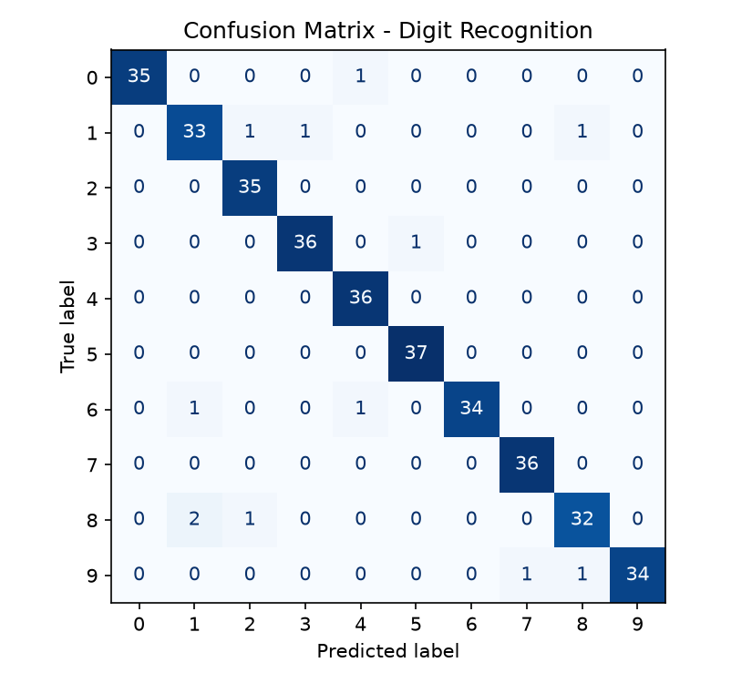
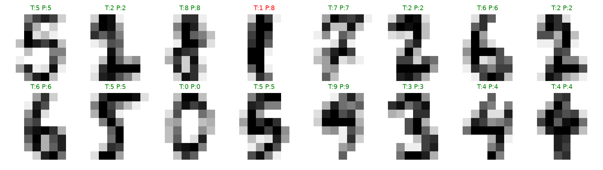
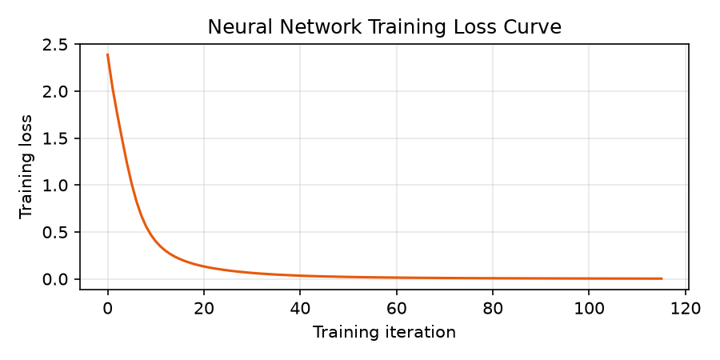
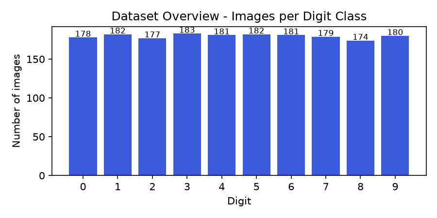

# Handwritten Digit Recognition using Neural Networks (MLP)

A supervised machine learning model that classifies 8x8 handwritten digit images (0–9) using a Multi-Layer Perceptron (MLP) Neural Network in Python (`scikit-learn`, `NumPy`, `Matplotlib`).

- **Dataset:** 1,797 grayscale images (80% Train / 20% Test split)
- **Architecture:** 64 -> 64 (ReLU) -> 32 (ReLU) -> 10 (Softmax)
- **Training Accuracy:** 100.00%
- **Test Accuracy:** 96.67%

## Results & Visualizations

